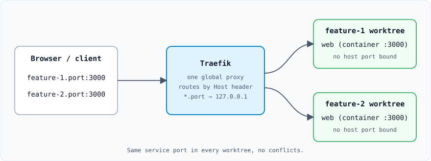

# Port

[](https://www.npmjs.com/package/@jdtzmn/port)
[](https://github.com/jdtzmn/port/actions/workflows/ci.yml)
[](./LICENSE.md)
[](https://nodejs.org)

**Port CLI runs Docker Compose services in parallel Git worktrees—no port conflicts, with Traefik-routed local branch domains.**

<p align="center">
  
</p>

## Why Port

A Docker Compose stack that publishes a host port works in one worktree but fails when a second worktree starts the same service:

```text
Error starting userland proxy: listen tcp4 0.0.0.0:3000: bind: address already in use
```

Port gives each worktree its own Compose project and removes conflicting host-port bindings. Traefik routes requests to the right worktree by hostname, so both stacks can use the same service ports at once.

- **Worktree management**: create, enter, rename, and remove Git worktrees with one command
- **Branch domains**: `<branch>.port:3000` and `<service>.<branch>.port` instead of port numbers
- **Host processes**: route non-Docker processes (like `npm run dev`) through the same domains with `port run`
- **Lifecycle hooks**: run scripts after worktree creation, `port up`, and before `port run`
- **Agent friendly**: ships an installable [Agent Skill](./docs/setup.md#agent-skill) for coding agents

Compared with other tools? See [alternatives](./docs/alternatives.md).

## Requirements

- Node.js 22.5+
- Git 2.7+
- Docker & Docker Compose v2.24.0+
- macOS or Linux

## Install

```bash
npm install -g @jdtzmn/port
# or
bun add -g @jdtzmn/port
```

## Quick start

```bash
# One-time: resolve *.port to 127.0.0.1 and add the shell hook
port install

# In your project: create (or enter) a worktree, then start its services
port feature-1
port up
# Services available at feature-1.port

# In another terminal, a second worktree with the same ports
port feature-2
port up
# Services available at feature-2.port
```

Port works with your existing `docker-compose.yml`. Optionally run `port init` to scaffold `.port/config.jsonc`, hooks, and templates, or set options by hand:

```jsonc
{
  // Optional, defaults to "port"
  "domain": "port",

  // Optional, defaults to "docker-compose.yml"
  "compose": "docker-compose.yml",
}
```

For a guided walkthrough, run `port onboard`.

## Everyday commands

| Command                           | Description                                                |
| --------------------------------- | ---------------------------------------------------------- |
| `port <branch>`                   | Enter a worktree (creates it if needed)                    |
| `port up [services...]`           | Start Compose services in the current worktree             |
| `port down [services...]`         | Stop services                                              |
| `port run <port> -- <command...>` | Run a host process routed through Traefik                  |
| `port urls [service]`             | Show service URLs for the current worktree                 |
| `port status`                     | Show service status across all worktrees                   |
| `port exit`                       | Return to the repository root                              |
| `port remove <branch>`            | Remove a worktree and clean up its Docker resources        |
| `port doctor`                     | Diagnose prerequisites, routing, and project configuration |

Use `port enter <branch>` when a branch name collides with a command (such as `status`). `port enter` also accepts GitHub issue and PR URLs.

## Documentation

- [Setup](./docs/setup.md): DNS, shell integration, completions, agent skill
- [Commands](./docs/commands.md): full command reference and usage details
- [Hooks](./docs/hooks.md): lifecycle hooks and environment variables
- [How Port works](./docs/how-it-works.md): architecture, host process routing, custom 404 handler, compose overrides
- [Docker cleanup](./docs/docker-cleanup.md): what `remove`, `prune`, and `cleanup` delete
- [Remote VM services](./docs/remote-services.md): route services running on SSH hosts
- [Development](./docs/development.md): contributing, benchmarks, Linux test container
- [PLAN.md](./PLAN.md): design notes and detailed configuration options

## License

[MIT](./LICENSE.md)
